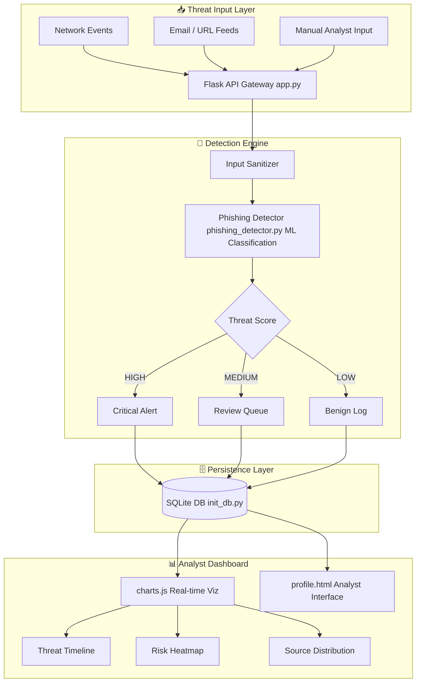
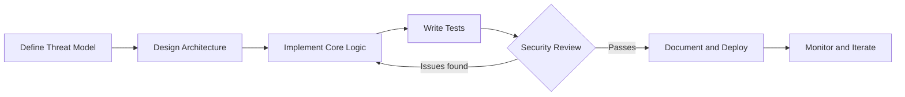

<!-- ╔══════════════════════════════════════════════════════════════════════╗
     ║  CYBER//OPS — Security Engineering Workbench                         ║
     ║  GitHub Profile README                                                ║
     ║  ─────────────────────────────────────────────────────────────────── ║
     ║  CUSTOMISATION GUIDE                                                  ║
     ║  1. Replace every [PLACEHOLDER] with your real information            ║
     ║  2. Update assets/header.svg — change [YOUR NAME] on line 62          ║
     ║  3. Replace [YOUR-USERNAME] with your GitHub username                 ║
     ║  4. Update project cards with real repo links                         ║
     ║  5. Remove placeholder sections that don't apply yet                  ║
     ╚══════════════════════════════════════════════════════════════════════╝ -->

<!-- ─────────────────────────────────────────────────
     HERO HEADER
     SVG rendered inline — no external service dependency
     ───────────────────────────────────────────────── -->

<div align="center">



</div>

---

<!-- ─────────────────────────────────────────────────
     INTRODUCTION
     ───────────────────────────────────────────────── -->

<div align="center">

```
┌─────────────────────────────────────────────────────────────────────┐
│  operator@cyberops:~$  whoami                                        │
│  > [YOUR NAME] — Cybersecurity Engineering Student                  │
│  > Focus: Threat Detection · AppSec · Security Tool Development     │
│  > Status: Actively learning, building, and contributing            │
└─────────────────────────────────────────────────────────────────────┘
```

</div>

I am a cybersecurity engineering student with hands-on experience building **security tools**, working through **adversarial labs**, and developing **detection-focused applications**. My work sits at the intersection of software engineering and practical security — I write code that either defends systems or understands how they fail.

My current focus areas are **application security**, **threat detection pipelines**, **penetration testing methodology**, and **security-oriented software development**. I believe the best security engineers also write solid code — so I treat both skills with equal discipline.

> *"Security is not a product, but a process."* — Bruce Schneier

---

<!-- ─────────────────────────────────────────────────
     QUICK STATS BAR
     ───────────────────────────────────────────────── -->

<div align="center">

| 🎯 Domain | 🔧 Primary Stack | 🏆 Platforms | 📍 Location |
|:---:|:---:|:---:|:---:|
| Cybersecurity Engineering | Python · Flask · SQL | TryHackMe · HackTheBox | [YOUR CITY, INDIA] |

</div>

---

<!-- ─────────────────────────────────────────────────
     FEATURED PROJECTS
     ───────────────────────────────────────────────── -->

## `> featured_projects.load()`

### 🛡️ Defence Cyber Shield — Real-Time Threat Detection Dashboard

<table>
<tr>
<td width="55%">

**Problem:** Security teams need centralized visibility across phishing attempts, anomalous network events, and threat intelligence — most open-source dashboards lack an integrated ML-based detection layer.

**Solution:** A full-stack cybersecurity monitoring platform that combines a Flask-based web application, a machine-learning phishing detection engine, a real-time analytics dashboard, and a persistent threat database.

**Architecture highlights:**
- `phishing_detector.py` — ML classification engine for URL/email threat scoring
- `app.py` — Flask REST API routing threat events and dashboard data
- `init_db.py` — Database schema initialization and seed pipeline
- `charts.js` — Real-time D3/Chart.js threat visualization layer
- `profile.html` — Analyst profile and configuration interface

**Security considerations:**
- Input sanitization on all ingested threat indicators
- Role-scoped data access patterns
- Audit logging for analyst actions

</td>
<td width="45%" align="center">

**Tech Stack**


**Status**


<br/>

**[→ View Repository](https://github.com/[YOUR-USERNAME]/defence-cyber-shield)**
&nbsp;·&nbsp;
**[→ Read Docs](#)**

</td>
</tr>
</table>

<details>
<summary><strong>🔬 Architecture — Defence Cyber Shield</strong></summary>



</details>

---

### 📦 `[PROJECT-2-NAME]` — [One-line description]

> **[PLACEHOLDER]** — Add your second project here. Include the problem it solves, the tech stack, and a link to the repository. If you have no second project yet, remove this card or replace it with a "Currently Building" entry.

<table>
<tr>
<td width="55%">

**Problem:** [Describe the security or engineering problem]

**Technical approach:** [Describe your solution and key implementation decisions]

**Key components:**
- [Component 1 — role in system]
- [Component 2 — role in system]
- [Component 3 — role in system]

</td>
<td width="45%" align="center">


**[→ View Repository](https://github.com/[YOUR-USERNAME]/[REPO-NAME])**

</td>
</tr>
</table>

---

### 🔬 Currently Building

> **[PLACEHOLDER — describe a current work-in-progress or learning project]**

```
operator@cyberops:~/projects/[wip-project]$ git status
On branch main
  modified:   src/[file].py
  new file:   docs/architecture.md
  new file:   tests/test_[module].py

Target completion: [MONTH YEAR]
```

---

<!-- ─────────────────────────────────────────────────
     TECHNICAL SKILLS MATRIX
     ───────────────────────────────────────────────── -->

## `> skills.enumerate()`

<details open>
<summary><strong>⚔️ Offensive Security</strong></summary>

| Skill | Tools / Techniques | Level |
|:---|:---|:---:|
| Web Application Penetration Testing | Burp Suite · OWASP Top 10 · SQLi · XSS · IDOR | Learning |
| Network Reconnaissance | Nmap · Netcat · Wireshark | Learning |
| Vulnerability Assessment | Manual analysis · CVE research | Learning |
| Social Engineering Analysis | Phishing indicator identification | Practicing |
| CTF Methodology | TryHackMe · HackTheBox rooms | Active |

</details>

<details>
<summary><strong>🛡️ Defensive Security</strong></summary>

| Skill | Tools / Techniques | Level |
|:---|:---|:---:|
| Threat Detection | Pattern matching · ML-based classification | Building |
| Log Analysis | System logs · Application logs · Anomaly detection | Learning |
| Incident Response Concepts | NIST framework · Triage methodology | Studying |
| SIEM Concepts | Alert correlation · Dashboard design | Learning |
| Network Traffic Analysis | Wireshark · Protocol dissection | Practicing |

</details>

<details>
<summary><strong>🔐 Application Security</strong></summary>

| Skill | Tools / Techniques | Level |
|:---|:---|:---:|
| Secure Coding Practices | Input validation · Output encoding · Least privilege | Practicing |
| OWASP Top 10 | Injection · Auth failures · SSRF · Misconfiguration | Studying |
| API Security | REST endpoint hardening · Auth token management | Learning |
| Database Security | SQL injection defense · Query parameterization | Practicing |

</details>

<details>
<summary><strong>💻 Programming and Automation</strong></summary>

| Language / Tool | Use Case | Proficiency |
|:---|:---|:---:|
| Python | Security tooling · Data pipelines · ML integration | Proficient |
| Flask | REST APIs · Web security dashboards | Proficient |
| JavaScript | Frontend visualization · Chart rendering | Intermediate |
| SQL / SQLite | Threat database design · Query optimization | Intermediate |
| Bash / PowerShell | Automation · Lab scripting | Learning |
| HTML / CSS | Security tool frontends | Intermediate |

</details>

<details>
<summary><strong>🌐 Operating Systems and Networking</strong></summary>

| Area | Detail |
|:---|:---|
| Linux | Kali Linux · Ubuntu — navigation, file system, process management |
| Windows | Analysis environments · AD concepts |
| Networking Fundamentals | TCP/IP · DNS · HTTP/S · OSI model |
| Protocols | SSH · FTP · SMTP · HTTP — packet-level understanding |

</details>

<details>
<summary><strong>☁️ DevSecOps and Cloud (Learning)</strong></summary>

| Area | Status |
|:---|:---:|
| Git / GitHub — version control, branching, PR workflow | Active |
| Docker — containerization basics | Learning |
| CI/CD pipeline concepts | Studying |
| Cloud security fundamentals (AWS/GCP) | [PLACEHOLDER — add if applicable] |

</details>

<details>
<summary><strong>🤖 AI-Assisted Security Engineering</strong></summary>

| Application | Detail |
|:---|:---|
| ML-based threat classification | Implemented in defence-cyber-shield phishing detector |
| Security data analysis | Pattern recognition in threat datasets |
| AI-augmented code review | Using LLM tools to identify logic vulnerabilities |

</details>

---

<!-- ─────────────────────────────────────────────────
     SECURITY WORKFLOW — EXPANDABLE TERMINAL SECTIONS
     ───────────────────────────────────────────────── -->

## `> workflow.inspect()`

<details>
<summary><strong>🔍 Penetration Testing Workflow</strong></summary>

```
┌──────────────────────────────────────────────────────┐
│  ENGAGEMENT LIFECYCLE — METHODOLOGY REFERENCE        │
├──────────────────────────────────────────────────────┤
│                                                      │
│  [1] RECONNAISSANCE                                  │
│      ├── Passive: OSINT, DNS enum, WHOIS             │
│      └── Active:  Nmap, banner grabbing              │
│                                                      │
│  [2] SCANNING & ENUMERATION                          │
│      ├── Service version detection                   │
│      ├── Directory/endpoint brute-force              │
│      └── SSL/TLS certificate analysis                │
│                                                      │
│  [3] VULNERABILITY IDENTIFICATION                    │
│      ├── Manual code review                          │
│      ├── CVE cross-reference                         │
│      └── OWASP Top 10 checklist                      │
│                                                      │
│  [4] EXPLOITATION (Lab/CTF only)                     │
│      ├── Controlled proof-of-concept                 │
│      └── Documented with full evidence               │
│                                                      │
│  [5] REPORTING                                       │
│      ├── Risk-rated findings                         │
│      ├── Remediation recommendations                 │
│      └── Technical + executive summary               │
│                                                      │
│  NOTE: All offensive techniques practiced in         │
│  authorized lab environments only (TryHackMe,        │
│  HackTheBox, personal lab VMs).                      │
└──────────────────────────────────────────────────────┘
```

</details>

<details>
<summary><strong>🏗️ Security Tool Development Process</strong></summary>



</details>

<details>
<summary><strong>📚 Current Learning Objectives</strong></summary>

```
operator@cyberops:~/learning$ cat roadmap.md

## Active
  [x] Flask web application security patterns
  [x] ML-based phishing detection implementation
  [x] TryHackMe — [COMPLETED PATH NAME]
  [ ] Complete OWASP WebGoat lab series
  [ ] HackTheBox — Starting Point track completion
  [ ] Build a network packet analyzer in Python

## 2025 Targets
  [ ] eJPT certification preparation
  [ ] Contribute to an open-source security tool
  [ ] Complete 50+ TryHackMe rooms
  [ ] [PLACEHOLDER — add your specific goal]
```

</details>

---

<!-- ─────────────────────────────────────────────────
     ACHIEVEMENTS & CREDENTIALS
     ───────────────────────────────────────────────── -->

## `> credentials.verify()`

<table>
<tr>
<td width="50%">

### 🏅 Platforms and Labs

| Platform | Status / Achievement |
|:---|:---:|
| TryHackMe | Active — [PLACEHOLDER: X rooms completed] |
| HackTheBox | Active — [PLACEHOLDER: Starting Point] |
| [PLACEHOLDER] | [Add additional platform] |

</td>
<td width="50%">

### 📜 Certifications

| Credential | Issuer | Status |
|:---|:---|:---:|
| [PLACEHOLDER] | [Issuer] | In Progress |
| [PLACEHOLDER] | [Issuer] | Planned |

> **Note:** Add only verified credentials. Do not list in-progress courses as earned certifications.

</td>
</tr>
</table>

### 🎯 CTF and Security Challenges

| Challenge / Event | Category | Result | Notes |
|:---|:---|:---:|:---|
| [PLACEHOLDER — CTF name] | Web · Crypto · Forensics | [Rank/Flag captured] | [Key technique used] |
| [PLACEHOLDER — Room name] | TryHackMe | Completed | [What you learned] |

> **[PLACEHOLDER]** — Add your actual CTF write-ups and challenge completions here. Link to write-up posts if available.

---

<!-- ─────────────────────────────────────────────────
     GITHUB ANALYTICS
     ───────────────────────────────────────────────── -->

## `> analytics.render()`

<!-- IMPORTANT: Replace [YOUR-USERNAME] with your actual GitHub username in ALL URLs below -->

<div align="center">

<a href="https://github.com/[YOUR-USERNAME]">
  
</a>
&nbsp;
<a href="https://github.com/[YOUR-USERNAME]">
  
</a>

</div>

<div align="center">


</div>

<div align="center">


</div>

> **Fallback:** If any analytics card fails to load, visit [github.com/[YOUR-USERNAME]](https://github.com/[YOUR-USERNAME]) directly to view contribution history.

---

<!-- ─────────────────────────────────────────────────
     SECURITY PRINCIPLES
     ───────────────────────────────────────────────── -->

## `> principles.display()`

```
┌──────────────────────────────────────────────────────────────────┐
│  ENGINEERING PRINCIPLES                                          │
├──────────────────────────────────────────────────────────────────┤
│                                                                  │
│  01  Understand the attack surface before writing a defence.     │
│                                                                  │
│  02  Code that can't be read can't be trusted.                   │
│      Write clear, documented, auditable implementations.         │
│                                                                  │
│  03  Security is an engineering discipline, not a checklist.     │
│      Build it into the architecture, not onto it.               │
│                                                                  │
│  04  Every claim needs evidence.                                 │
│      CVEs cited. Tools tested. Lab environment documented.       │
│                                                                  │
│  05  Responsible disclosure. Always.                             │
│      Offensive skills are used only in authorized contexts.      │
│                                                                  │
└──────────────────────────────────────────────────────────────────┘
```

---

<!-- ─────────────────────────────────────────────────
     CONTACT
     ───────────────────────────────────────────────── -->

## `> contact.init()`

<div align="center">

<table>
<tr>
<td align="center" width="160">

**GitHub**
<br/>
[](https://github.com/[YOUR-USERNAME])

</td>
<td align="center" width="160">

**LinkedIn**
<br/>
[](https://linkedin.com/in/[YOUR-LINKEDIN-HANDLE])

</td>
<td align="center" width="160">

**Email**
<br/>
[](mailto:[YOUR-EMAIL@DOMAIN.COM])

</td>
<td align="center" width="160">

**TryHackMe**
<br/>
[](https://tryhackme.com/p/[YOUR-THM-USERNAME])

</td>
</tr>
</table>

<br/>

```
operator@cyberops:~$ echo "Open to security engineering roles, internships, and collaborations."
Open to security engineering roles, internships, and collaborations.
operator@cyberops:~$ █
```

</div>

---

<div align="center">

<sub>Built with discipline · No fabricated metrics · No inflated claims · Evidence-first</sub>

<sub><strong>CYBER//OPS</strong> profile · Updated [MONTH YEAR] · [YOUR NAME]</sub>


</div>
